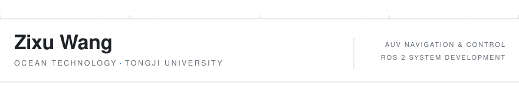
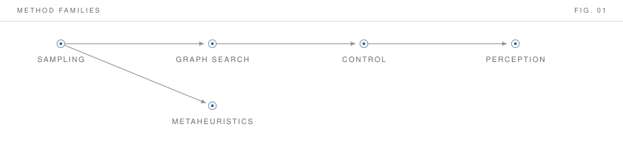

  <picture>
    <source media="(prefers-color-scheme: dark)" srcset="assets/header-dark.svg">
    
  </picture>

  
  
  
  
  

  Ocean Technology graduate student at Tongji University. 
  AUV navigation &amp; control by training; local-first research tooling by night.

  <a href="https://github.com/kingside33/littrace">littrace</a> &nbsp;·&nbsp;
  <a href="https://github.com/kingside33/Tavotto">Tavotto</a> &nbsp;·&nbsp;
  <a href="https://orcid.org/0009-0002-9299-9503">ORCID</a>

## Now

<table>
  <tr>
    <td width="33%" valign="top">
       
      <b><a href="https://github.com/kingside33/littrace">littrace</a></b> 
      A local-first workbench that traces how papers inherit from and improve on each other, and answers questions with quotes that point back to a page. Reads a Zotero library and never writes to it.
    </td>
    <td width="33%" valign="top">
       
      <b><a href="https://github.com/kingside33/Tavotto">Tavotto</a></b> 
      Publication-ready figures: multi-panel layout in millimetres, journal rule checks before export, so a figure fails on the drawing board rather than at submission.
    </td>
    <td width="33%" valign="top">
       
      <b><a href="https://github.com/kingside33/claude-code-pr-review-respond">claude-code-pr-review-respond</a></b> 
      A Claude Code skill that closes the review loop on GitHub pull requests: fetch the comments, fix what is valid, push, reply in the thread, resolve.
    </td>
  </tr>
</table>

## Research

  <picture>
    <source media="(prefers-color-scheme: dark)" srcset="assets/lineage-dark.svg">
    
  </picture>

AUV navigation and control, path planning, and ROS 2 system development.
The figure above is the method taxonomy littrace uses for robotics and
path-planning literature — a display grouping, not a claim about citation counts.

## 关于我

同济大学海洋技术方向研究生，做 AUV 导航与控制、ROS 2 系统开发。
业余在写让科研证据不被弄丢的工具：本地优先、只读集成、答案必须能点回原文。

  Zixu Wang &nbsp;·&nbsp; <a href="https://orcid.org/0009-0002-9299-9503">ORCID 0009-0002-9299-9503</a>

